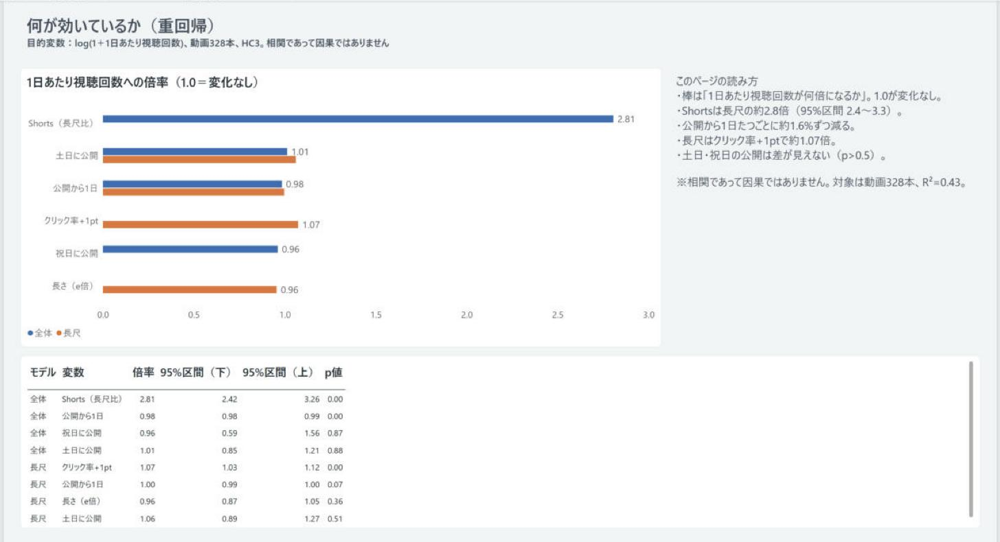
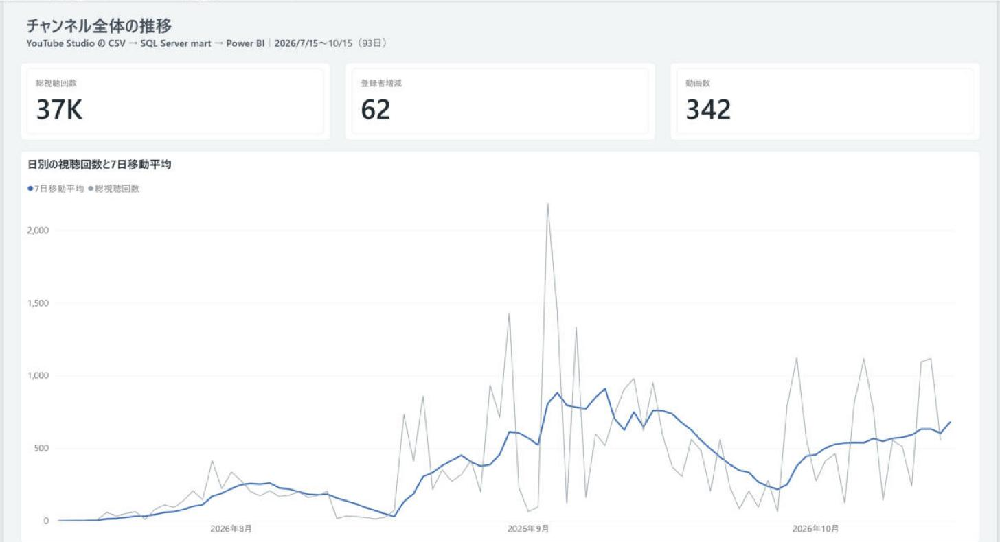
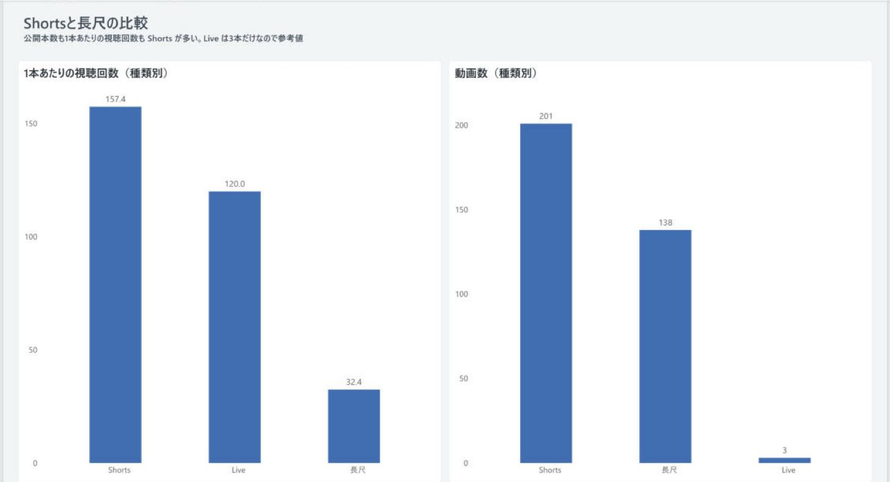
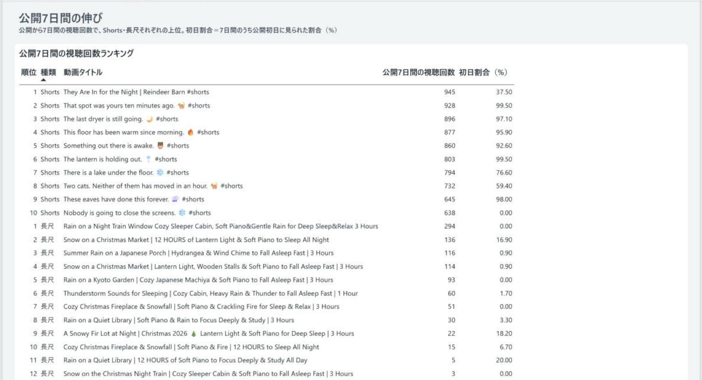
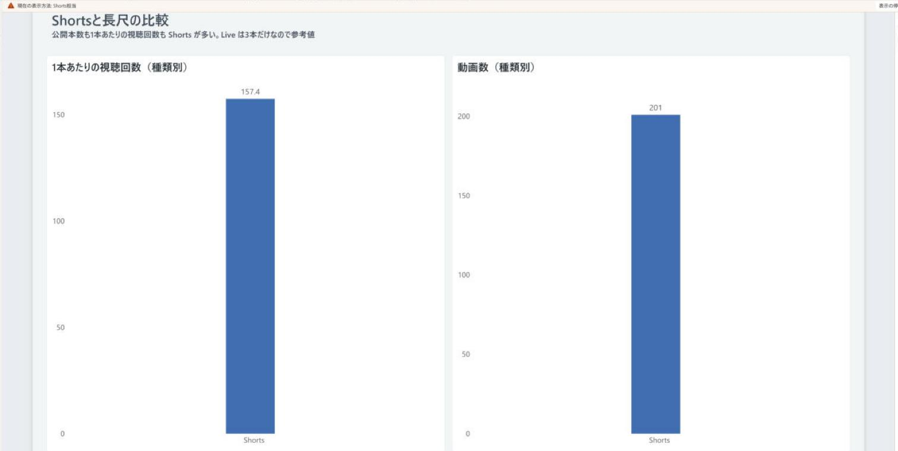
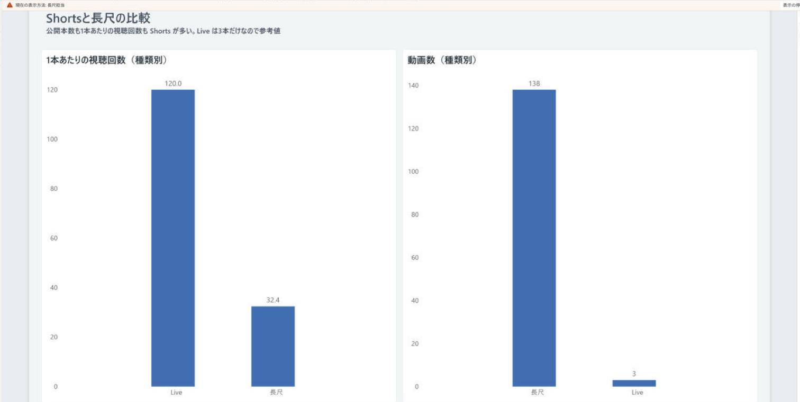
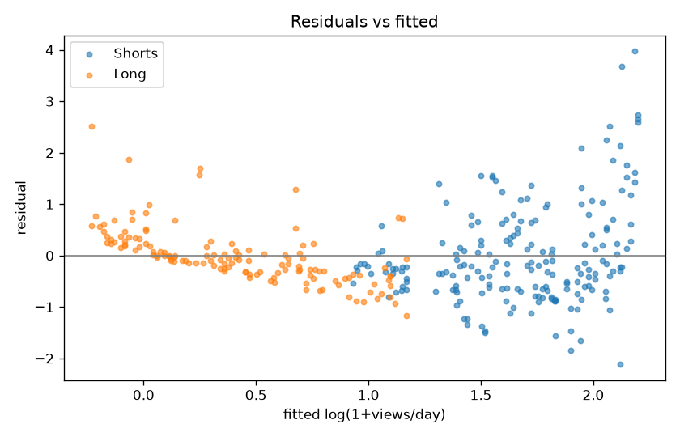
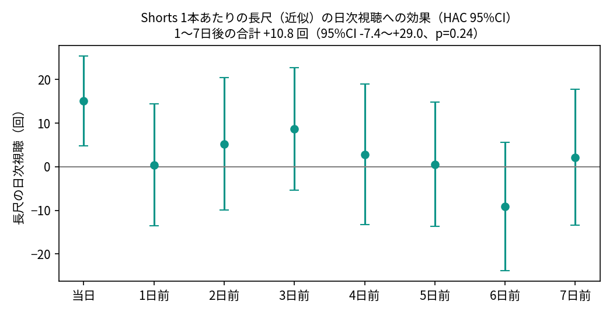
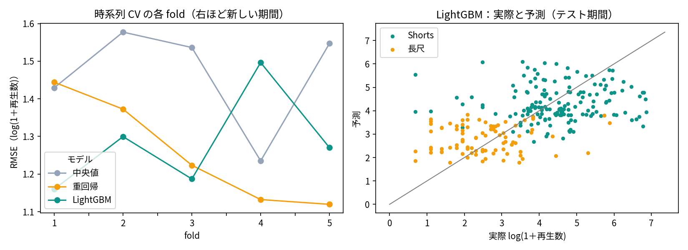
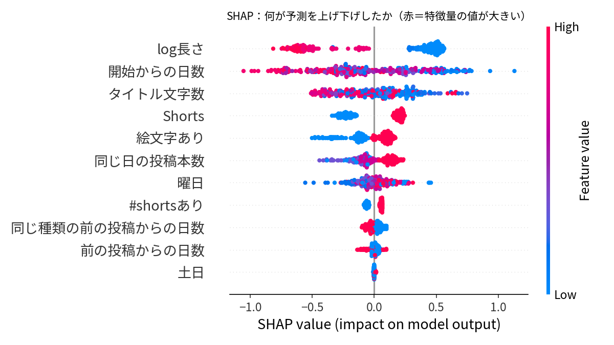

# youtube-data-mart

**Summary (English)**
- **Goal:** Analyze my own YouTube channel (93 days, 342 videos, Jul–Oct 2026) to see what views are associated with, using a data pipeline that gives the same numbers every time it runs.
- **Data flow:** YouTube Studio CSV → pandas → SQL Server staging → star-schema data mart (CTEs, window functions, surrogate keys) → Power BI (DAX, row-level security) → regression and prediction in Python.
- **Tools:** Python (pandas, statsmodels, scikit-learn, LightGBM, SHAP), SQL Server, Power BI; the 7-day moving-average view was also reproduced in BigQuery with matching results.
- **Findings (associations, not causal effects):** after adjusting for days since publishing, Shorts get about 2.8x the daily views of long-form videos (95% CI 2.4–3.3); for long-form videos, higher thumbnail click-through rate goes with more views.
- **Prediction:** with only information known at publish time, time-series cross-validated RMSE was 1.27 (OLS) and 1.29 (LightGBM) vs 1.47 for a median baseline; type and length drive most of the prediction.
- **Try it without SQL Server:** `python src/try_sample.py` runs on the small sample in `data/sample/`.

- **何を**：自分の YouTube チャンネル（2026年7〜10月の93日・342本）のデータを、pandas → SQL Server のデータマート → Power BI と整え、再生数が何と関連しているかを回帰と予測モデルで調べた。
- **なぜ**：CSV を直接 Power BI で読むだけでは、数字が正しいか確かめにくい。取り込み・保管・分析を分けて、何度流しても同じ数字が出る形にしたうえで分析したかった。
- **何がわかったか**：公開からの日数をそろえると、Shorts は長尺の約2.8倍見られている（関連）。長尺ではクリック率の高さと視聴回数に関連がある。Shorts を出した翌週に長尺の視聴が増えるという関連は、この期間でははっきり見えなかった。




この図からわかること：1を上回る区間になっているのは Shorts（全体、2.4〜3.3倍）とクリック率（長尺、1.03〜1.12倍）だけ。詳しくは下の「分かったこと」。

更新日：2026-10-19（予測モデル・SHAP、Shorts→長尺の検証、BigQuery 版を追加）／2026-10-20：英語の要約・代表の図・サンプルデータを追加

## 目的
1本目（youtube-analytics-powerbi）は CSV を Power BI で直接読んでいた。2本目では、取り込み（pandas）→ 保管（SQL Server の stg）→ 分析用の形（mart のスタースキーマ）→ 可視化（Power BI）→ 要因分析（重回帰）を分け、**何度流しても同じ数字が出るデータの流れ**を作る。そのうえで「動画の視聴回数が何と関連しているか」を数字で確かめる。

## データの流れ
```
YouTube Studio の CSV ─▶ pandas（src/load_stg.py）─▶ SQL Server stg ─▶ SQL Server mart（スタースキーマ・ビュー）
                                                                            ├─▶ Power BI（レポート・RLS）
                                                                            └─▶ 要因分析（statsmodels / scikit-learn）
```

### mart のテーブル（sql/02_create_mart.sql・03_load_mart.sql）
| 種類 | テーブル | 1行の単位 |
|---|---|---|
| ディメンション | dim_date（再帰 CTE で作る。曜日・週・月・祝日フラグ） | 日 |
| ディメンション | dim_video（代理キー video_key／業務キー video_id） | 動画 |
| ディメンション | dim_content_type（Shorts／長尺／Live） | 種類 |
| ディメンション | dim_traffic_source・dim_subscription_source | 流入元・登録元 |
| ファクト | fact_channel_daily | 日 |
| ファクト | fact_video_daily | 動画×日（上位24本） |
| ファクト | fact_traffic_daily・fact_subscription_daily | 流入元×日・登録元×日 |
| ファクト | fact_video_summary | 動画（期間合計） |

### mart のビュー（sql/04_views.sql）
| ビュー | 中身 | 使った構文 |
|---|---|---|
| mart.v_channel_ma7 | 日別の視聴回数と7日移動平均 | AVG() OVER (ROWS 6 PRECEDING)・LAG |
| mart.v_channel_weekly_wow | 週ごとの視聴回数と前週比 | CTE・LAG |
| mart.v_video_rank_first7 | 公開7日間の視聴回数の種類別順位 | CTE・ROW_NUMBER() OVER (PARTITION BY) |
| mart.v_video_features | 重回帰用の動画単位の表 | JOIN |

## 使った技術
Python（pandas・SQLAlchemy・pyodbc・statsmodels・scikit-learn）／SQL Server（CTE・再帰 CTE・ウィンドウ関数・代理キー）／Power BI（スタースキーマ・RLS）

## サンプルで試す（SQL Server なし・3行）
元の CSV は入れていないので、集計済みの小さいサンプル（`data/sample/`：日別の視聴回数93日分と、動画40本の種類・長さ・視聴回数）で動きを確かめられる。
1. `pip install pandas`
2. リポジトリのいちばん上のフォルダで `python src/try_sample.py`
3. 10/14 の7日移動平均 602.29（mart.v_channel_ma7 と同じ値）と、種類ごとの視聴回数の中央値が表示される
- 重回帰・予測モデル（notebooks/）は全342本の CSV（data/raw/）が要るので、サンプルだけでは動かない

## 再現の手順
1. `pip install -r requirements.txt`
2. `.env.example` を `.env` にコピーし、接続文字列を自分の環境に合わせる（Windows 認証・ODBC Driver 17/18）
3. SSMS で `sql/00_create_database.sql` → `sql/01_create_stg.sql` を実行
4. `python src/load_stg.py`（CSV → stg。`data/raw/` に YouTube Studio のエクスポートを置く）
5. `python src/run_sql.py sql/02_create_mart.sql sql/03_load_mart.sql sql/04_views.sql`（mart とビュー。確認クエリの結果も表示）
6. `python notebooks/e_03_regression.py`・`notebooks/e_04_regression_check.py`（要因分析）
- Windows では `run_load_stg.bat` → `run_mart.bat` → `run_regression_check.bat` をダブルクリックでも同じ

## フォルダ
| フォルダ | 中身 |
|---|---|
| docs/ | 設計・答え合わせのメモ |
| sql/ | DDL（00 データベース・01 stg・…）と確認用 SQL |
| src/ | pandas の取り込み（load_stg.py） |
| notebooks/ | 要因分析のノートブック |

## 答え合わせ
| 確認 | 結果 |
|---|---|
| stg 6テーブルの行数・合計が CSV と一致 | ○ |
| mart ファクトの行数・合計が stg と一致、ディメンションに結びつかない行 0件 | ○ |
| 10/14 の7日移動平均 602.29・10/13 631.71（1本目の SQL・Power BI と同じ） | ○ |
| 93日・14週の視聴回数合計 36,577 | ○ |
| Shorts の公開7日間1位「They Are In for the Night」945回（初日354・37.5%） | ○ |
| v_video_features：使える行 329・欠損が pandas の下見と一致 | ○ |

## データ品質のチェック
`sql/06_data_quality_checks.sql` を mart を作った後に流すと、43項目の合格／不合格が一覧で出る（`python src/run_sql.py sql/06_data_quality_checks.sql` でも可）。
- 見ること：① stg と mart の行数の一致 ② 主キーの重複 ③ NULL の割合（キーと日別の数値は0%、動画の CSV は5%まで）④ 日付の欠け（日付テーブルが切れ目なくそろうか、日別×区分の行がそろうか）⑤ 合計値の一致（stg と mart、日別と登録元別）
- 結果（2026-10-20、同じロジックを手元の CSV と DuckDB で再現）：合格42・不合格0・注意1。注意は daily_metrics に行がない2日（7/14・7/16）で、mart では0で埋めている
- わざと mart の1日分を消すと、行数と合計のチェックが不合格になることも確かめた

## Power BI（youtube_data_mart.pbix・リポジトリには含めない）
mart の10テーブルとビュー・回帰結果（mart.regression_ratios）を読み込み、リレーションはすべて多対1・単方向。dim_date を日付テーブルに設定し、キー列は非表示。メジャーは表示フォルダ（チャンネル／動画）に分けた。見た目は自作テーマ（powerbi/theme_youtube_mart.json）でそろえた。

| ページ | 中身 |
|---|---|
| 1 全体の推移 | 日別の視聴回数と7日移動平均（DAX の DATESINPERIOD）、総視聴回数・登録者増減・動画数 |
| 2 Shortsと長尺 | 種類別の1本あたり視聴回数と動画数（Live は3本だけなので参考値） |
| 3 公開7日間の伸び | v_video_rank_first7 の種類別ランキング（初日の割合つき） |
| 4 何と関連しているか | 重回帰の倍率（全体／長尺）と95%信頼区間・p値。相関であって因果ではない |

#### 図1　全体の推移（ページ1）


この図からわかること：日別の視聴回数は8月末から増え、9月上旬に7日移動平均で約900回のピーク、10月は500〜700回前後で推移している。

#### 図2　Shorts と長尺（ページ2）


この図からわかること：1本あたりの視聴回数は Shorts 157回・長尺 32回で、本数も Shorts のほうが多い（201本と138本）。

#### 図3　公開7日間の伸び（ページ3）


この図からわかること：Shorts の上位は公開7日間で600〜950回、長尺の上位は300回未満。Shorts は多くが初日に7日分のほとんどを集める。

#### 図4　何と関連しているか（ページ4）


この図からわかること：重回帰の倍率と95%信頼区間を全体・長尺で並べたもの。1を上回る区間になっているのは Shorts（全体、2.4〜3.3）とクリック率（長尺、1.03〜1.12）だけ。

### 行レベルセキュリティ（RLS）
| ロール | 見える範囲 |
|---|---|
| Shorts担当 | content_type = "Shorts" |
| 長尺担当 | content_type が "長尺" または "Live"（Live は3本だけなので長尺担当が持つ） |

「ロールとして表示」で、それぞれ自分の担当分だけが出ることを確かめた。

#### 図5　Shorts 担当で表示


この図からわかること：Shorts 担当のロールでは、Shorts の動画と数値だけが表示される。

#### 図6　長尺担当で表示


この図からわかること：長尺担当のロールでは、長尺と Live だけが表示される。

## 分かったこと（重回帰・328本・目的変数は log(1＋1日あたりの視聴回数)・HC3）
どれも「関連がある」という結果で、原因かどうかは言えない（公開日や形式は自分で選んでおり、比較の条件をそろえた実験ではない）。

- 公開からの日数をそろえると、Shorts は長尺の約2.8倍、1日あたりに見られている（95%信頼区間 2.4〜3.3）
- 公開からの日数が1日長いほど、1日あたりの視聴回数は約1.6% 少ない
- 長尺では、クリック率（サムネイル）が1ポイント高い動画ほど1日あたり約1.07倍見られている。土日・祝日の公開や動画の長さとは、はっきりした関連が見えなかった
- 5-fold CV の R² は 0.42 ± 0.09。詳しくは [docs/2026-10-18_要因分析の結果.md](docs/2026-10-18_要因分析の結果.md)

#### 図7　残差と予測値


この図からわかること：長尺（橙）は予測値が大きいほど残差が下に寄り、Shorts（青）はばらつきが大きい。等分散を仮定しにくいので、頑健な標準誤差（HC3）を使った。

### Shorts を出すと長尺の視聴は増えるか（日次・分布ラグ回帰・HAC）

長尺の日次視聴（全体 −「ショート フィード」−「関連のショート動画」経由で近似）を、Shorts の投稿本数（当日〜7日前）・曜日・トレンド・長尺の投稿本数で回帰した（86日、Newey–West ラグ7）。Shorts を出した当日は長尺（近似）の視聴が1本あたり約 +15 回多いという関連があるが、新しい Shorts 自身がブラウジング・検索経由で得た視聴の混入でほぼ説明でき、純粋な長尺（上位12本）では差がない。翌日〜7日後の合計は +10.8 回（95%CI −7.4〜+29.0）で、この期間では Shorts の投稿と長尺の視聴の増加にはっきりした関連は見えない。期間が短く CI が広いので「効果がない」とも言えず、投稿日は自分で選んでいるため因果も言えない。詳細は [notebooks/e_05_shorts_to_longform.ipynb](notebooks/e_05_shorts_to_longform.ipynb)。

#### 図8　Shorts の投稿本数と長尺の日次視聴（ラグ別の係数）


この図からわかること：当日（左端）だけ区間が0より上で、1〜7日後はどれも区間が0をまたいでいる。

### 公開時点の情報で再生数を予測する（LightGBM・時系列 CV・SHAP）

公開前にわかる情報だけ（種類・長さ・曜日・直前の投稿からの日数・同じ日の投稿本数・タイトルの文字数／絵文字／#shorts・開始からの日数）で、log(1＋公開後の再生数) を予測した（公開から7日以上たった299本。Shorts は累計の99%以上が7日以内に来るので≒7日の再生数、長尺は累計）。公開日順の TimeSeriesSplit（5分割）で、RMSE は中央値 1.47・重回帰 1.27・LightGBM 1.29。予測への寄与が大きいのは種類と長さ（Shorts・短い動画ほど多い）と時期で、SHAP の向きは重回帰の係数とほぼ一致した（Shorts／#shorts／長さは同じ情報を分け合うため重回帰の符号は不安定）。Shorts だけではどのモデルも中央値に勝てず、Shorts 同士の差は公開前の情報では説明できない。→ 曜日やタイトルを変えても予測はほとんど動かないので、公開後24時間の初速を見て、伸びた型に寄せるほうがよさそう（予測モデルなので、変えたら伸びるという因果は確かめていない）。詳細は [notebooks/e_06_predict_views.ipynb](notebooks/e_06_predict_views.ipynb)。

#### 図9　時系列 CV の RMSE と、実際と予測


この図からわかること：重回帰も LightGBM も、5つの期間のうち4つで中央値より誤差が小さい。どちらが良いかは期間で入れ替わる。右の図では Shorts（緑）と長尺（橙）が分かれて予測されている。

#### 図10　SHAP（何が予測を上げ下げしたか）


この図からわかること：長さが短い（青）ほど、また Shorts であるほど予測が上がる。曜日・投稿間隔・土日の寄与は小さい。

### BigQuery でも同じことができる
7日移動平均・前週同曜日のビュー（`mart.v_channel_ma7`）を BigQuery サンドボックスに移し、SQL Server 版と同じ値（合計 36,577・10/14 の移動平均 602.29）になることを確かめた → [extras/bigquery](extras/bigquery)

## SQL の練習問題
- [SQL 面接用の5問](docs/SQL面接用の5問.md)：gaps and islands（連続して伸びた日数）・前週比の上位・パレート（上位20%の占有率）・種類別の中央値（PERCENTILE_CONT）・ROW_NUMBER での重複除去
