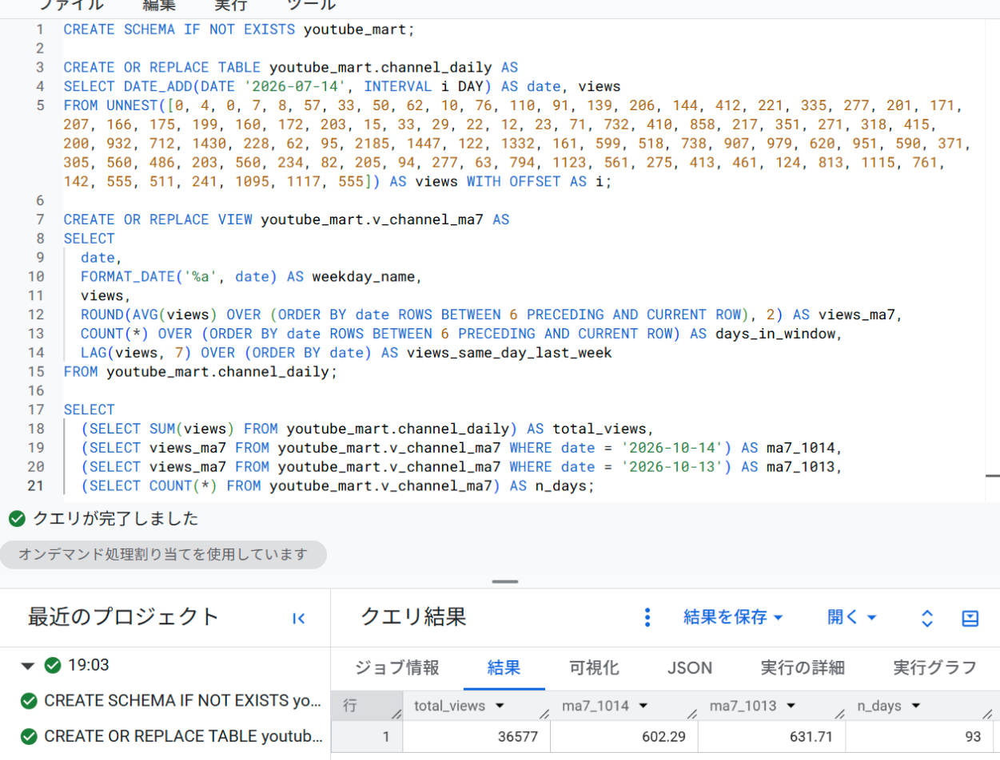

# extras/bigquery：同じウィンドウ関数を BigQuery でも

求人32件（2026-10-19 時点）で、手元にないスキルとしていちばん多く出てきたのが BigQuery（12件・うち必須4件）。E の SQL Server 版 `mart.v_channel_ma7`（7日移動平均・前週同曜日の値）を、BigQuery サンドボックス（無料・カード不要）に移した。教材は買わず、参考は公式ドキュメントだけ。

## ファイル
| ファイル | 中身 |
|---|---|
| `channel_daily.csv` | 日別の視聴回数（2026-07-14〜10-14、93日） |
| `01_load_channel_daily.sql` | データセット `youtube_mart` とテーブル `channel_daily` を作る（サンドボックスは INSERT が使えないので CREATE TABLE AS SELECT） |
| `02_v_channel_ma7.sql` | BigQuery 版のビュー（AVG OVER・COUNT OVER・LAG） |
| `03_check.sql` | SQL Server 版と同じ値になるかの答え合わせ |
| `bigquery_result.png` | 実行結果の画面 |

## 答え合わせ（2026-10-19 実行）
| 項目 | SQL Server 版 | BigQuery 版 |
|---|---|---|
| 93日の合計 | 36,577 | 36,577 |
| 10/14 の7日移動平均 | 602.29 | 602.29 |
| 10/13 の7日移動平均 | 631.71 | 631.71 |
| 行数 | 93 | 93 |

## SQL Server からの書き換えで変えたところ
| SQL Server | BigQuery |
|---|---|
| `CAST(AVG(CAST(views AS decimal(10,2))) OVER (...) AS decimal(10,2))` | `ROUND(AVG(views) OVER (...), 2)`（AVG は FLOAT64 を返すので CAST 不要） |
| `dim_date` を JOIN して曜日名を取る | `FORMAT_DATE('%a', date)` |
| `[date]`（予約語の角かっこ） | `date`（そのまま使える） |
| `CREATE OR ALTER VIEW mart.v_...` ＋ `GO` | `CREATE OR REPLACE VIEW youtube_mart.v_...`（スクリプトで続けて実行できる） |
| `INSERT` でデータを入れる | サンドボックスでは DML 不可 → `CREATE TABLE AS SELECT` か CSV アップロード |

参考：[Try BigQuery using the sandbox](https://docs.cloud.google.com/bigquery/docs/sandbox)／[Explore BigQuery in the Google Cloud console](https://docs.cloud.google.com/bigquery/docs/bigquery-web-ui)
